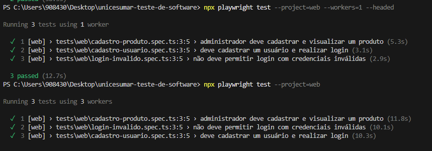

# Atividade 04 – Automação de Testes E2E com Playwright

## 1. Objetivo

Esta atividade tem como objetivo desenvolver testes automatizados End-to-End (E2E) utilizando o Playwright, verificando o funcionamento de funcionalidades da aplicação ServeRest por meio da interface web.

Os testes foram desenvolvidos para validar operações de cadastro, autenticação e gerenciamento de produtos, simulando ações realizadas por usuários reais no sistema.

**Aplicação utilizada:** https://front.serverest.dev/

**API utilizada:** https://serverest.dev/

## 2. Tecnologias utilizadas

- **Node.js:** ambiente de execução JavaScript.
- **TypeScript:** linguagem utilizada no desenvolvimento dos testes.
- **Playwright:** ferramenta de automação e testes E2E.
- **ServeRest:** aplicação utilizada como ambiente de testes.
- **Git e GitHub:** controle de versão e compartilhamento do código.

## 3. Estrutura do projeto

Os arquivos desenvolvidos para esta atividade estão organizados da seguinte maneira:

```text
tests/
└── web/
    ├── fixtures/
    │   └── admin.fixture.ts
    ├── cadastro-produto.spec.ts
    ├── cadastro-usuario.spec.ts
    └── login-invalido.spec.ts

READMEATIV4.md
```

### Descrição dos arquivos

- **admin.fixture.ts:** contém a fixture personalizada responsável por criar um usuário administrador por meio da API e realizar sua autenticação pela interface web.
- **cadastro-produto.spec.ts:** realiza o cadastro de um produto utilizando uma sessão autenticada de administrador e verifica sua presença na listagem.
- **cadastro-usuario.spec.ts:** realiza o cadastro de um novo usuário e verifica a possibilidade de autenticação com as credenciais cadastradas.
- **login-invalido.spec.ts:** verifica o comportamento do sistema diante de uma tentativa de login com credenciais inválidas.

## 4. Cenários de testes implementados

### 4.1 Cadastro de usuário e autenticação

O primeiro cenário verifica o processo de cadastro de um novo usuário pela interface do ServeRest.

O teste realiza as seguintes etapas:

1. Acessa a página inicial da aplicação.
2. Seleciona a opção de cadastro de usuário.
3. Preenche os campos com nome, e-mail e senha.
4. Realiza o cadastro.
5. Retorna à tela de login.
6. Informa as credenciais cadastradas.
7. Verifica se a autenticação foi realizada com sucesso.

Para evitar conflitos entre execuções, são utilizados dados dinâmicos, especialmente no endereço de e-mail.

### 4.2 Cadastro e listagem de produtos

O segundo cenário verifica a funcionalidade de cadastro de produtos, utilizando uma fixture personalizada para disponibilizar uma página autenticada como administrador.

A fixture utiliza a API para criar um usuário com privilégios administrativos e, em seguida, realiza o login pela interface web.

Após a autenticação, o teste:

1. Acessa a opção de cadastro de produtos.
2. Preenche os campos de nome, preço, descrição e quantidade.
3. Realiza o cadastro.
4. Acessa a listagem de produtos.
5. Verifica se o produto cadastrado está presente na listagem.

Os dados do produto também são gerados dinamicamente para evitar duplicidade entre execuções.

### 4.3 Login com credenciais inválidas

O terceiro cenário verifica a segurança do processo de autenticação diante de dados incorretos.

O teste:

1. Acessa a página inicial do ServeRest.
2. Informa um endereço de e-mail inexistente.
3. Informa uma senha incorreta.
4. Tenta realizar o login.
5. Verifica se a mensagem de erro é apresentada.
6. Confirma que o usuário não obteve acesso autenticado.

## 5. Fixture personalizada

Para o cenário de cadastro de produtos, foi utilizada a funcionalidade `test.extend()` do Playwright, permitindo criar uma fixture personalizada chamada `adminPage`.

Essa abordagem possibilita reutilizar o processo de autenticação administrativa sem repetir as mesmas operações diretamente no teste.

O processo é dividido em duas partes:

- **Preparação:** criação do usuário administrador por meio de uma requisição à API.
- **Execução:** autenticação do administrador pela interface web e disponibilização da página autenticada para o teste.

Dessa forma, a fixture facilita a organização do código, reduz a repetição e permite que o cenário de cadastro de produtos seja executado de maneira independente.

## 6. Execução dos testes

Para executar os testes, é necessário ter o Node.js instalado e as dependências do projeto configuradas.

A instalação das dependências pode ser realizada com:

```bash
npm install
```

Para instalar o navegador Chromium utilizado pelo Playwright:

```bash
npx playwright install chromium
```

Para executar exclusivamente os testes da interface web:

```bash
npx playwright test --project=web
```

Para executar os testes com o navegador visível:

```bash
npx playwright test --project=web --workers=1 --headed
```

## 7. Resultados obtidos

Após a implementação e os ajustes necessários nos seletores dos elementos da interface, os três cenários foram executados com sucesso.

**Resultado final:**

- Cadastro de usuário e autenticação: aprovado.
- Cadastro e listagem de produtos: aprovado.
- Login com credenciais inválidas: aprovado.

**Total: 3 testes aprovados.**

## 8. Evidências da execução

Nesta seção devem ser inseridas as capturas de tela que demonstram a execução dos cenários automatizados.



## 9. Repositório

O código-fonte desenvolvido para a atividade está disponível no repositório:

https://github.com/QAkarotto/unicesumar-teste-de-software

**Branch utilizada:** `feature/e2e-playwright-patrick`

