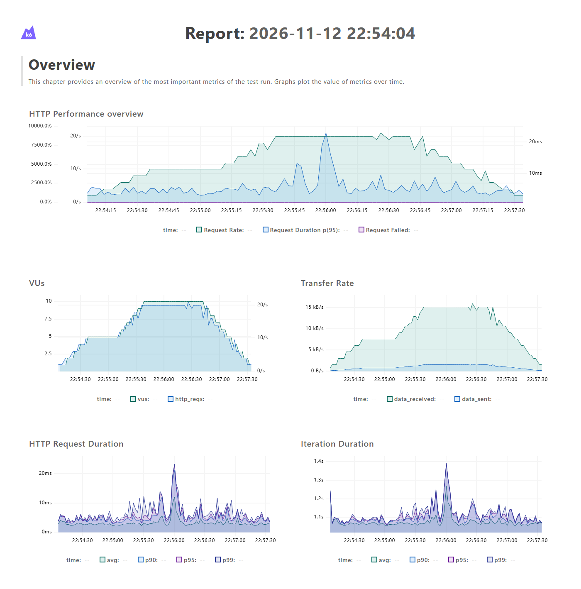
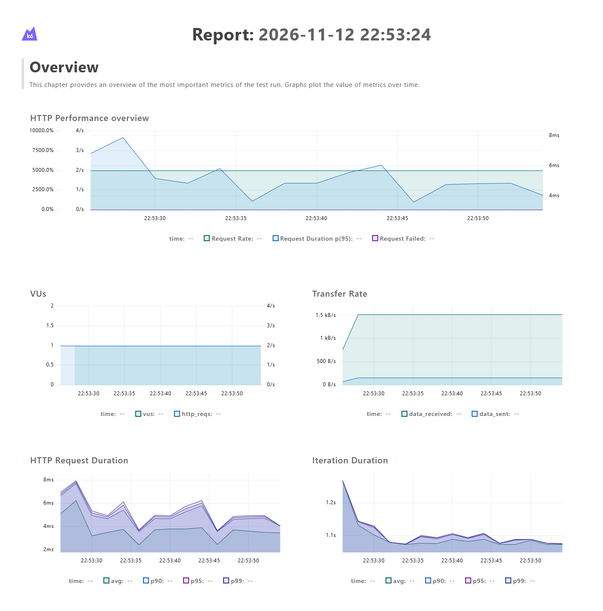
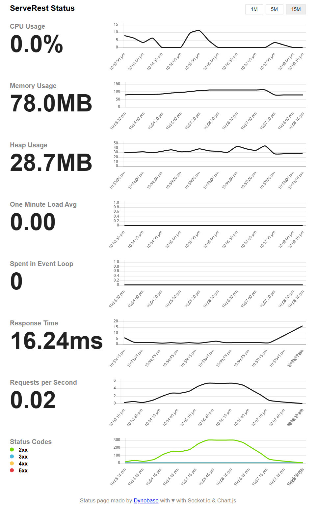

# Parte 4 — Relatório de desempenho do ServeRest

## Ambiente e método

Os testes rodaram em 2026-11-12 com k6 v2.4.0 e ServeRest v3.2.2 (`npx serverest@latest`), os dois na mesma máquina — Intel Xeon E5-2670 v3 (12 núcleos / 24 threads), 32 GB de RAM, Windows 10 — e comunicando por `localhost`. O ServeRest estava com a massa de dados inicial: 2 produtos e 1 usuário, respostas de cerca de 0,4 kB. Detalhes e respostas de conferência em [evidencias/ambiente.txt](../evidencias/ambiente.txt).

Cada iteração de um VU faz `GET /produtos`, `GET /usuarios` e pausa 1 s. Cada cenário foi executado duas vezes, em sequência e contra a mesma instância do ServeRest: a execução **oficial**, com painel gráfico, em [evidencias/cenario-1/](../evidencias/cenario-1/) e [evidencias/cenario-2/](../evidencias/cenario-2/), e uma **repetição** em [evidencias/repeticao/](../evidencias/repeticao/), usada para medir quanto os números variam de uma execução para outra. Os valores numéricos deste relatório vêm do resumo do k6 (`terminal.txt` e `resumo.json`).

| Cenário | Executor | Perfil de VUs | Duração |
| --- | --- | --- | --- |
| 1 — carga inicial | `constant-vus` | 1 VU constante | 30 s |
| 2 — carga progressiva | `ramping-vus` com `stages` | começa com 1; sobe a 5 em 30 s; mantém 5 por 30 s; sobe a 10 em 30 s; mantém 10 por 60 s; desce a 5 em 30 s; desce a 0 em 30 s | 3 min 30 s |

## Critérios de desempenho

Os thresholds são os mesmos nos dois cenários (definidos em [testes/comum.js](../testes/comum.js)), para que a diferença entre os resultados reflita a carga e não critérios diferentes. O cenário 2 acrescenta o critério de p95 por patamar.

| Threshold | Critério | Justificativa |
| --- | --- | --- |
| `http_req_failed: rate<0.01` | menos de 1% das requisições com erro | São leituras numa API local, sem rede no caminho: erro aqui indica defeito, não instabilidade de infraestrutura. 1% é o limite do exemplo de thresholds da documentação do k6 e corresponde a 99% de disponibilidade durante o teste. No cenário 1, com 60 requisições, uma única falha já reprova (1/60 = 1,7%). |
| `http_req_duration: p(95)<200` | 95% das respostas em menos de 200 ms | Uma tela que lista produtos e usuários faz as duas chamadas. Com até 200 ms cada, a tela completa fica bem abaixo de 1 s, o limite de Nielsen para o usuário não perder o fluxo da navegação. É também o SLO de exemplo da documentação do k6. O valor fica muito acima da linha de base local (≈ 5 ms), e isso é proposital: o critério expressa o requisito de quem usa a API, e não o resultado obtido — calibrá-lo pela própria medição tornaria o teste circular. Ele também precisa continuar válido quando houver rede entre cliente e servidor, o que soma latência a cada chamada. |
| `http_req_duration: p(99)<500` | 99% das respostas em menos de 500 ms | Controla a cauda que o p95 não vê: a fila que se forma sob concorrência aparece primeiro nos percentis mais altos. Com 500 ms, mesmo 1 requisição em cada 100 fica dentro da metade do limite de 1 s. |
| `http_req_duration{endpoint:produtos}` e `{endpoint:usuarios}`: `p(95)<200` | o critério de p95 em cada endpoint | O p95 global mistura os dois endpoints, e um endpoint lento poderia ficar escondido atrás do rápido. |
| `http_req_duration{fase:patamar-5}` e `{fase:patamar-10}`: `p(95)<200` (só cenário 2) | o critério de p95 em cada patamar de carga | O p95 da execução inteira mistura as rampas, com poucos VUs, e o pico. Avaliar cada patamar garante que o critério vale com 5 e com 10 VUs, e deixa visível no resumo do k6 o efeito do aumento de carga. |
| `checks: rate>0.99` | pelo menos 99% das verificações aprovadas | Checks não reprovam o teste sozinhos. Este threshold faz com que respostas erradas — status diferente de 200, ou lista que não confere com o campo `quantidade` — reprovem a execução, com o mesmo patamar de 99% usado para os erros HTTP. |

## Resultados

### Comparativo das execuções oficiais

| Métrica | Cenário 1 — carga inicial | Cenário 2 — carga progressiva |
| --- | --- | --- |
| Usuários virtuais | 1, constante | 1 → 5 → 10 → 5 → 0 (máximo 10) |
| Duração da execução | 30,3 s | 3 min 30,4 s |
| Total de requisições | 60 | 2.720 |
| Taxa de requisições | 1,98 req/s | 12,93 req/s na média da execução; ≈ 20 req/s no patamar de 10 VUs |
| Iterações | 30 | 1.360 |
| Tempo médio de resposta | 3,76 ms | 3,44 ms |
| Mediana | 3,77 ms | 2,75 ms |
| p95 | 6,34 ms | 7,61 ms |
| p99 | 7,49 ms | 15,25 ms |
| Máximo | 8,00 ms | 23,44 ms |
| Taxa de falhas | 0,00% (0 de 60) | 0,00% (0 de 2.720) |
| Checks | 100% (120 de 120) | 100% (5.440 de 5.440) |
| Thresholds | 6 de 6 aprovados | 8 de 8 aprovados |

Por endpoint, `/produtos` foi um pouco mais lento que `/usuarios` nos dois cenários — p95 de 6,69 ms contra 4,63 ms no cenário 1, e 7,94 ms contra 7,17 ms no cenário 2 —, coerente com o corpo maior (dois registros contra um).

### Tempo de resposta por nível de carga

A tabela separa o cenário 2 nos seus dois patamares, pela tag `fase`, e põe ao lado o cenário 1 (1 VU). As duas linhas de cada nível são a execução oficial e a repetição. Tempos em milissegundos.

| Nível de carga | Requisições | Execução | Média | Mediana | p95 | p99 | Máximo |
| --- | --- | --- | --- | --- | --- | --- | --- |
| 1 VU (cenário 1) | 60 | oficial | 3,76 | 3,77 | 6,34 | 7,49 | 8,00 |
| 1 VU (cenário 1) | 60 | repetição | 3,03 | 2,86 | 5,17 | 8,22 | 11,98 |
| 5 VUs (patamar do cenário 2) | ≈ 300 | oficial | 2,79 | 2,63 | 5,18 | 6,15 | 7,72 |
| 5 VUs (patamar do cenário 2) | ≈ 300 | repetição | 2,66 | 2,53 | 4,21 | 5,58 | 14,13 |
| 10 VUs (patamar do cenário 2) | ≈ 1.200 | oficial | 4,05 | 2,92 | 11,05 | 17,56 | 23,44 |
| 10 VUs (patamar do cenário 2) | ≈ 1.200 | repetição | 3,02 | 2,62 | 5,92 | 9,00 | 17,15 |

As quantidades por patamar são estimadas (VUs × duração × 2 requisições por segundo); o resumo do k6 traz as estatísticas de tempo da submétrica, mas não a contagem. Nas repetições, a execução completa do cenário 2 teve 2.722 requisições, média de 2,95 ms e p95 de 5,75 ms, também sem falhas e com todos os thresholds aprovados.

### Evolução ao longo da execução

Cenário 2, execução oficial — vazão, VUs e tempo de resposta ao longo do tempo ([relatório completo](../evidencias/cenario-2/painel-k6.html)):

Cenário 1, execução oficial ([relatório completo](../evidencias/cenario-1/painel-k6.html)):

Lado do servidor — página `/status` do ServeRest, janela de 15 minutos, capturada logo após as duas execuções oficiais:

## Como o aumento da carga afetou o desempenho

**A vazão acompanhou a carga, sem saturar.** Cada VU produziu cerca de 2 req/s em todos os níveis: 1,98 req/s com 1 VU e ≈ 20 req/s com 10 VUs. No modelo fechado, os stages do cenário 2 somam 1.365 VU·s de execução; com iterações de 1,008 s em média, isso prevê ≈ 1.355 iterações, e foram medidas 1.360 e 1.361. Quem determinou a taxa foi, portanto, o número de VUs com a pausa de 1 s, e não o servidor: se o ServeRest tivesse virado gargalo, as iterações se alongariam e a contagem ficaria abaixo da previsão. A duração média da iteração ficou entre 1,007 s e 1,009 s em todas as execuções — 1 s de pausa mais cerca de 7 ms das duas requisições.

**O tempo de resposta típico não mudou.** A mediana ficou entre 2,5 e 3,8 ms em todos os níveis, e a média entre 2,7 e 4,1 ms. Multiplicar a taxa de requisições por dez, de 1 para 10 VUs, não moveu a mediana além do que ela varia entre execuções. O cenário 1 oficial chegou a ter a mediana mais alta (3,77 ms) porque foi a primeira carga sobre um ServeRest recém-iniciado: o painel mostra o p95 perto de 8 ms nos primeiros segundos, caindo para 4–6 ms. A repetição, com o servidor já aquecido, teve mediana de 2,86 ms.

**A cauda cresceu com a concorrência.** Nas duas execuções, p95 e p99 no patamar de 10 VUs ficaram acima dos do patamar de 5 VUs. O p95 subiu 113% na oficial (5,18 → 11,05 ms) e 41% na repetição (4,21 → 5,92 ms); o p99 subiu 186% e 61%. É o comportamento esperado de um servidor Node.js, que executa o JavaScript numa única thread: quanto mais requisições por segundo, maior a chance de duas chegarem juntas e uma esperar a outra. Essa espera aparece nas requisições mais lentas, não na mediana. A **magnitude**, porém, não se reproduziu. Na execução oficial, a maior parte do excesso vem de um pico transitório por volta de 22:56:00, visível no painel e responsável pelo máximo de 23 ms, que não ocorreu na repetição. As métricas coletadas não permitem distinguir a causa — coleta de lixo do Node.js ou atividade de outro processo na máquina são candidatas.

**Nenhuma falha, e nenhum critério perto do limite.** Foram 5.562 requisições nas quatro execuções, sem nenhum erro e com 100% dos checks aprovados. O pior p95 (11,05 ms) usou 5,5% do orçamento de 200 ms, e o pior p99 (17,56 ms), 3,5% do de 500 ms. No servidor, a página `/status` registrou CPU do processo com pico de cerca de 11%, memória entre 80 e 110 MB e nenhuma resposta 4xx ou 5xx.

## Limitações na interpretação dos dados

- **Gerador e sistema na mesma máquina.** k6 e ServeRest disputaram a mesma CPU, e parte do tempo medido é trabalho do próprio gerador. Por outro lado, `localhost` elimina a latência de rede, então os tempos absolutos (≈ 3 ms) ficam muito abaixo do que um cliente veria pela internet. Os números servem para comparar os níveis de carga entre si, não para estimar o tempo de resposta em produção.
- **Volume pequeno por definição.** No máximo 10 VUs e 20 req/s, como a atividade pede, sem teste de estresse. Os resultados não se extrapolam: não ter havido degradação até 10 VUs não diz nada sobre 100 ou 1.000. Achar o limite exigiria um teste de estresse ou de _breakpoint_.
- **Modelo fechado.** Com `constant-vus` e `ramping-vus`, a taxa depende do tempo de resposta (_coordinated omission_): se o servidor ficasse lento, o k6 enviaria menos requisições e esconderia parte da degradação. Aqui o tempo de resposta foi menos de 1% da duração da iteração, então o efeito é desprezível; perto da saturação, um executor de modelo aberto como o `ramping-arrival-rate` seria o mais adequado.
- **Massa de dados mínima.** `GET /produtos` e `GET /usuarios` devolvem a coleção inteira, sem paginação, e o banco tinha 2 produtos e 1 usuário. Com volumes realistas, o custo de cada requisição cresce com a coleção: os tempos medidos são o melhor caso.
- **Amostras pequenas e poucas execuções.** O cenário 1 tem 60 requisições, então o p95 é decidido pelas 3 mais lentas e o p99 praticamente coincide com o máximo. As duas execuções de cada cenário mostraram que diferenças de cauda de poucos milissegundos variam quase 2× entre execuções. Só a direção do efeito (a cauda cresce com a carga) é consistente; quantificá-lo exigiria mais repetições e patamares mais longos.
- **Aquecimento.** O cenário 1 oficial foi a primeira carga sobre o servidor recém-iniciado e inclui o aquecimento — por isso 1 VU pareceu mais lento que 5 VUs.
- **Ambiente não controlado.** A estação de trabalho Windows tinha outros programas abertos. O ServeRest registra cada requisição no console, o que soma trabalho por requisição, e a página `/status` no Windows não informa _load average_ nem tempo no event loop (os dois aparecem zerados). Os gráficos do painel do k6 agregam por aproximação a cada período — a duração de iteração no gráfico, por exemplo, passa do máximo de 1,04 s registrado no resumo —, então servem para ver a evolução no tempo, e os valores numéricos deste relatório vêm do resumo.

## Conclusão técnica

Nos dois cenários o ServeRest atendeu todos os critérios com folga: zero falhas, 100% dos checks e p95 de no máximo 11 ms contra um limite de 200 ms. Multiplicar a carga por dez, de 2 para 20 req/s, aumentou a vazão na mesma proporção e não alterou o tempo de resposta típico. O único efeito observável foi o alongamento da cauda (p95 e p99) no patamar de 10 VUs, consistente em direção nas duas execuções, mas de magnitude instável e na escala de milissegundos. Dentro da faixa testada, portanto, o aumento de carga não degradou o desempenho de forma relevante. Os dados não sustentam nenhuma conclusão sobre cargas maiores, e os tempos absolutos valem para este ambiente local, não para o uso da API pela rede.

## Referências

- Grafana Labs. [Thresholds](https://grafana.com/docs/k6/latest/using-k6/thresholds/) — exemplos `http_req_failed: ['rate<0.01']` e `http_req_duration: ['p(95)<200']`.
- Grafana Labs. [Open and closed models](https://grafana.com/docs/k6/latest/using-k6/scenarios/concepts/open-vs-closed/).
- Grafana Labs. [Web dashboard](https://grafana.com/docs/k6/latest/results-output/web-dashboard/).
- ServeRest. [README — Teste de carga](https://github.com/ServeRest/ServeRest#teste-de-carga).
- Nielsen, J. [Response Times: The 3 Important Limits](https://www.nngroup.com/articles/response-times-3-important-limits/). Nielsen Norman Group, 1993.
