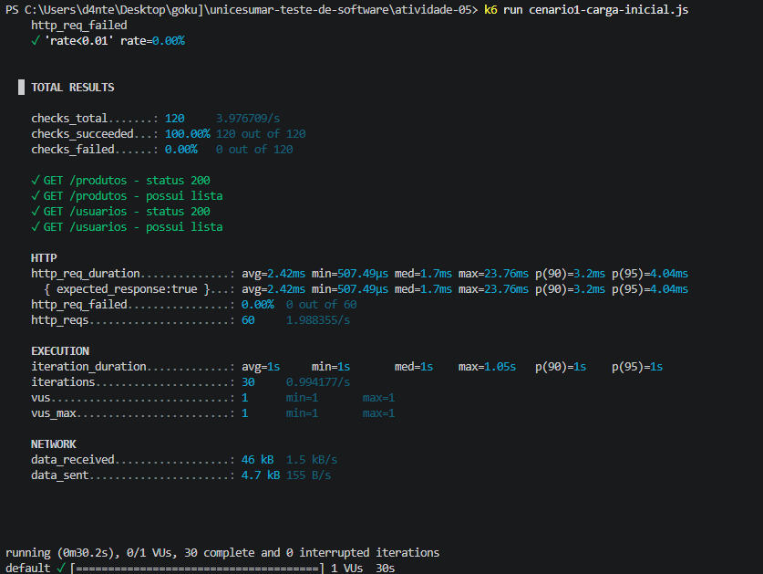
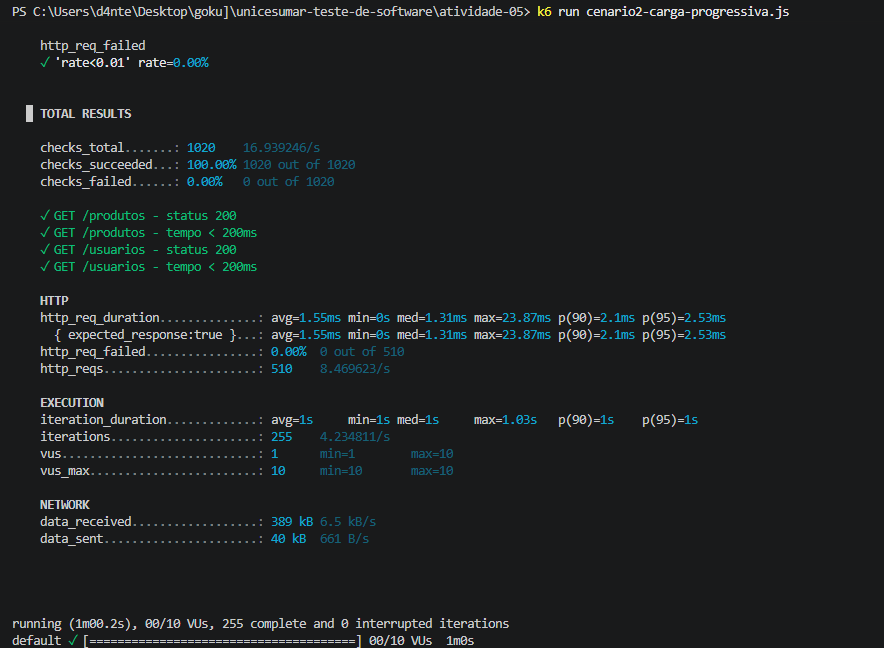

# Atividade 05 - 2BIM: Testes de Desempenho com k6 no ServeRest

## Parte 1 — Pesquisa sobre k6

### 1. Qual é a finalidade dos testes de desempenho e como os testes de carga se diferenciam dos testes funcionais?
Os testes de desempenho têm como finalidade avaliar o comportamento, a velocidade, a estabilidade e a escalabilidade de um sistema sob uma carga de trabalho específica, medindo métricas não funcionais como tempo de resposta e vazão (*throughput*). Enquanto os **testes funcionais** validam *o que* o sistema faz (se uma funcionalidade atende às regras de negócio em execuções isoladas), os **testes de carga** verificam *como* o sistema se comporta quando múltiplos utilizadores acedem à aplicação simultaneamente.

### 2. O que são usuários virtuais (VUs) e como eles influenciam a carga gerada?
Usuários Virtuais (*Virtual Users* - VUs) são instâncias de execução independentes e concorrentes que simulam utilizadores reais a executar o fluxo definido no script de teste em paralelo. Quanto maior o número de VUs simultâneos, maior é a concorrência de ligações e o volume de requisições por segundo enviados ao servidor, aumentando a exigência de processamento e memória da API.

### 3. Qual é a diferença entre checks e thresholds no k6?
- **Checks:** São validações booleanas (asserções) usadas para verificar condições durante a execução (como validar se o status HTTP é `200`). Se um *check* falhar, o k6 regista a falha estatística, mas **não interrompe** o teste nem retorna erro de execução.
- **Thresholds:** São metas e critérios de aprovação de desempenho (SLAs) definidos sobre as métricas globais (ex.: `p(95)<200`). Se um *threshold* não for cumprido, o teste falha oficialmente no final da execução (retornando código de saída diferente de zero).

### 4. O que representam as métricas `http_req_duration`, `http_req_failed` e `http_reqs`?
- **`http_req_duration`:** Tempo total de duração da requisição HTTP (desde o envio do pedido até à receção completa da resposta).
- **`http_req_failed`:** Taxa percentual de requisições que falharam (erros de ligação/timeout ou status HTTP `4xx` e `5xx`).
- **`http_reqs`:** Quantidade total de requisições HTTP geradas durante o teste e a taxa média de requisições por segundo (RPS).

### 5. Qual é a importância do percentil 95 (p95) na análise dos tempos de resposta?
A média simples (`avg`) pode mascarar lentidões severas caso poucas requisições demorem muito e a maioria seja rápida. O **percentil 95 (p95)** mostra o tempo máximo de resposta para 95% das requisições realizadas, permitindo avaliar a experiência real da grande maioria dos utilizadores e identificar estrangulamentos na cauda de latência.

---

## Parte 2 — Instruções para Configurar e Executar os Testes Localmente

### 1. Iniciar a API ServeRest localmente
Num terminal dedicado, execute:
```bash
npx.cmd serverest@latest
```
*(Ou via Docker: `docker run -p 3000:3000 paulogoncalvesbh/serverest:latest`)*

Confirme que a API está ativa acedendo a `http://localhost:3000/status`.

### 2. Instalar o k6
No Windows (via Winget):
```bash
winget install k6 --source winget
```

### 3. Executar os cenários de teste
Abra um segundo terminal na pasta `atividade-05` e execute:
```bash
# Executar Cenário 1 (Carga Inicial)
k6 run cenario1-carga-inicial.js

# Executar Cenário 2 (Carga Progressiva)
k6 run cenario2-carga-progressiva.js

# Opcional: alterar a URL da API via variável de ambiente
k6 run -e BASE_URL=http://localhost:3000 cenario1-carga-inicial.js
```

---

## Parte 3 — Critérios de Desempenho (Thresholds) e Justificativa

Nos scripts implementados (`cenario1-carga-inicial.js` e `cenario2-carga-progressiva.js`), foram adotados os seguintes *thresholds*:
- **`http_req_duration: ['p(95)<200', 'avg<100']`:** Como os testes ocorrem localmente (`localhost`) sem latência de rede externa e com base de dados em memória, 95% das respostas devem ocorrer abaixo de 200ms e a média abaixo de 100ms.
- **`http_req_failed: ['rate<0.01']`:** Tolerância máxima de falhas técnicas inferior a 1% para garantir disponibilidade sob carga moderada.
- **`checks: ['rate>0.99']`:** Garante que os endpoints `/produtos` e `/usuarios` mantenham o retorno esperado (`200 OK` e corpo JSON válido) durante toda a execução.

---

## Parte 4 — Relatório Comparativo e Análise dos Resultados

### Tabela Comparativa

| Métrica | Cenário 1 (Carga Inicial) | Cenário 2 (Carga Progressiva) |
| :--- | :--- | :--- |
| **Quantidade de VUs** | 1 VU fixo | 1 -> 5 -> 10 -> 0 VUs (máx 10) |
| **Duração da Execução** | 30s (30.2s total) | 60s (1m00.2s total) |
| **Total de Iterações** | 30 (0.99/s) | 255 (4.23/s) |
| **Total de Requisições (`http_reqs`)** | 60 | 510 |
| **Taxa de Requisições (`req/s`)** | 1.98 req/s (1.988355/s) | 8.47 req/s (8.469623/s) |
| **Tempo Médio de Resposta (`avg`)** | 2.42 ms | 1.55 ms |
| **Tempo Mediano / Máximo** | med: 1.70 ms / max: 23.76 ms | med: 1.31 ms / max: 23.87 ms |
| **Percentil 90 (`p90`)** | 3.20 ms | 2.10 ms |
| **Percentil 95 (`p95`)** | 4.04 ms | 2.53 ms |
| **Taxa de Falhas (`http_req_failed`)** | 0.00% (0 de 60) | 0.00% (0 de 510) |
| **Resultado dos Checks** | 100.00% (120 de 120) | 100.00% (1020 de 1020) |
| **Resultado dos Thresholds** | Aprovado | Aprovado |

### Análise Técnica e Limitações
1. **Efeito do aumento de carga no ServeRest:** O aumento gradual de 1 até 10 utilizadores virtuais no Cenário 2 elevou o volume total de requisições de 60 para 510 e mais do que quadruplicou a taxa de vazão (*throughput* subiu de `1.98 req/s` para `8.47 req/s`), mantendo `0.00%` de falhas e `100%` de sucesso nos `checks` (1020 validações aprovadas). Observou-se ainda que o tempo médio (`1.55ms` contra `2.42ms`) e o percentil 95 (`2.53ms` contra `4.04ms`) foram ligeiramente menores no Cenário 2. Isto ocorre porque uma carga de até 10 VUs com leituras em memória (`NeDB`) não é suficiente para saturar o *Event Loop* do Node.js localmente, fazendo prevalecer o ganho de desempenho do aquecimento da máquina virtual (*JIT compilation* do motor V8 após o primeiro teste) e a reutilização de conexões TCP/HTTP (*Keep-Alive*).
2. **Limitações na interpretação dos dados:**
   - **Execução em Loopback (`localhost`):** Não há latência real de rede, encaminhamento ou *handshake* TLS, tornando os tempos de resposta medidos (na ordem de 1 a 4 milissegundos) muito inferiores aos de um ambiente real em nuvem.
   - **Partilha de Hardware:** Tanto o gerador de carga (k6) quanto a API (ServeRest) executaram na mesma máquina física, disputando a mesma CPU e memória RAM.
   - **Base de Dados em Memória:** O ServeRest utiliza armazenamento local leve com volume reduzido de registos iniciais, não refletindo estrangulamentos de leitura em disco (I/O) comuns em bases de dados relacionais de produção.

---

## Evidências da Execução

### 1. Execução do Cenário 1 — Carga Inicial


### 2. Execução do Cenário 2 — Carga Progressiva
