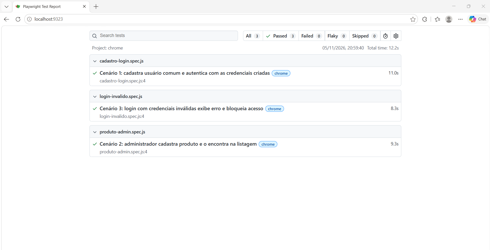

# Atividade 04 - Testes E2E com Playwright (ServeRest Front)

Testes E2E do [ServeRest Front](https://front.serverest.dev/) com `@playwright/test` (JavaScript).

## Pré-requisitos
- Node.js 18+
- Google Chrome instalado (o projeto usa `channel: 'chrome'`)

## Instalação
```bash
cd atividades/2bim/atividade-04-Solucao
npm install
```
Para usar o Chromium do Playwright no lugar do Chrome, rode `npx playwright install chromium` e remova `channel: 'chrome'` do `playwright.config.js`.

## Execução
```bash
npm test              # headless
npm run test:headed   # com navegador visível
npm run report        # abre o relatório HTML
```

## Cenários
| Arquivo | Cenário |
|---|---|
| `tests/cadastro-login.spec.js` | Cadastro e autenticação de usuário |
| `tests/produto-admin.spec.js` | Cadastro de produto pelo administrador (usa fixture) |
| `tests/login-invalido.spec.js` | Autenticação com credenciais inválidas |

## Decisões técnicas
- **Fixture** (`fixtures/auth.fixture.js`): `test.extend()` cria um administrador único via API (pré-condição) e entrega `adminPage`, já autenticada pela interface. A ação testada (cadastrar produto) ocorre toda pela interface.
- **Dados únicos** (`support/data.js`): timestamp + bytes aleatórios, evitando colisão entre testes paralelos.
- **Seletores**: `getByTestId` nos campos de formulário e no menu. O `data-testid` do botão de cadastrar produto é `cadastarProdutos` (grafia do próprio front).
- **Sem esperas fixas**: apenas auto-wait e asserções web-first (`toHaveURL`, `toBeVisible`). O timeout das asserções foi ampliado para 15s porque o ServeRest é uma API pública compartilhada e oscila sob carga.
- **Independência**: cada teste cria seus próprios dados e pode rodar em qualquer ordem e em paralelo.

## Evidência da execução
Execução padrão (`npx playwright test`), saída em [`evidencias/execucao.txt`](evidencias/execucao.txt):



Estabilidade: `--repeat-each=5` (15 execuções, 6 workers) passou 15 de 15, saída em [`evidencias/estabilidade.txt`](evidencias/estabilidade.txt).