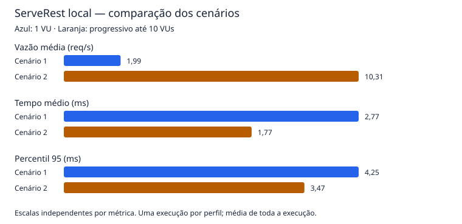

# Relatório — desempenho do ServeRest local

Autores: Gustavo Santana Barbosa e Lorenzo Rupel Bobeck.

## Método e ambiente

Execução em 06/11/2026, em macOS 27.0.1/ARM64, Apple M1 (8 CPUs lógicas), 8 GiB de RAM, Node.js 24.21.0, ServeRest 3.2.2 via NPM e k6 2.3.0. API e gerador no mesmo computador, com `BASE_URL=http://localhost:3000`. O [registro de ambiente](evidencias/ambiente.txt) confirma HTTP 200 em `/`, `/status`, `/produtos` e `/usuarios`. A consulta a `/status` confirmou a disponibilidade do painel; não foram coletadas séries de CPU/memória para atribuir gargalos.

Foram usados os dados iniciais da API: dois produtos e um usuário. Não houve alteração dos dados nem reinício da API entre os dois cenários definitivos. Uma execução preliminar foi descartada após correção de uma opção de configuração; portanto, a instância já havia recebido consultas antes da comparação. Não foi aplicado um protocolo formal de aquecimento.

Cada VU repete duas consultas sequenciais, primeiro `/produtos`, depois `/usuarios`, e espera 1 s. Cada resposta recebe dois checks: HTTP 200 e coerência da lista com `quantidade`. A falha de parsing JSON reprova o check. Apenas HTTP 200 é esperado pelo callback de métricas HTTP, e redirecionamentos estão desabilitados. As consultas de preparação foram realizadas fora do k6 e não entram nos totais abaixo.

O cenário 1 mantém 1 VU por 30 s. O cenário 2 começa com 1 VU e usa os stages: 10 s em 1, 15 s até 5, 15 s até 10, 10 s em 10, 10 s até 5 e 10 s até 0, totalizando 70 s. A redução respeita até 10 s para concluir iterações em andamento. São perfis de baixa carga, sem procurar o ponto de ruptura.

## Critérios definidos antes das execuções definitivas

| Threshold | Justificativa |
| --- | --- |
| `http_req_duration: p(95)<500` | Meta didática de resposta abaixo de meio segundo para pelo menos aproximadamente 95% das consultas. Evita avaliar somente a média. |
| `http_req_duration{endpoint:produtos}: p(95)<500` e equivalente para usuários | Aplica a mesma meta individualmente, evitando que o agregado esconda um endpoint lento. |
| `http_req_failed: rate<0.01` | Exige menos de 1% de falhas HTTP. Na amostra pequena de 60 requisições do cenário 1, até uma falha já ultrapassaria o limite. |
| `checks: rate==1` | Exige 100% de aprovação funcional nas respostas observadas, inclusive no JSON; uma resposta 200 com corpo incorreto deve reprovar o teste. |

Esses limites são hipóteses de aceitação acadêmicas, não um SLA publicado pelo ServeRest. Foram mantidos iguais nos dois perfis e não ajustados para acomodar os resultados. A taxa de falhas HTTP e a taxa de checks medem aspectos diferentes; nesta implementação, o threshold de checks também torna qualquer status inesperado motivo de reprovação.

## Resultados

| Métrica | Cenário 1 | Cenário 2 |
| --- | --- | --- |
| VUs | 1 constante | 1 → 5 → 10 → 5 → 0 |
| Duração nominal | 30 s | 70 s |
| Duração medida pelo k6 | 30,22 s | 70,41 s |
| Total de requisições | 60 | 726 |
| Requisições por segundo | 1,99 req/s | 10,31 req/s |
| Tempo médio | 2,77 ms | 1,77 ms |
| p95 | 4,25 ms | 3,47 ms |
| Tempo máximo | 32,05 ms | 57,28 ms |
| Falhas HTTP | 0/60 (0%) | 0/726 (0%) |
| Checks aprovados | 120/120 (100%) | 1.452/1.452 (100%) |
| Thresholds | 5/5 aprovados | 5/5 aprovados |
| Código de saída | 0 | 0 |

Valores arredondados a partir dos JSONs; o console pode truncar casas decimais.

A duração medida pelo k6 foi calculada por `http_reqs.count / http_reqs.rate`. Ela inclui a conclusão das iterações e pode exceder a duração nominal. Os timestamps dos logs abrangem também inicialização/encerramento do processo, por isso não são idênticos à janela usada pelo k6 para calcular RPS. A taxa informada é a média da execução inteira, não o pico no patamar de 10 VUs.

| Endpoint | Requisições C1 / C2 | Média C1 / C2 | p95 C1 / C2 |
| --- | --- | --- | --- |
| `GET /produtos` | 30 / 363 | 4,15 / 2,39 ms | 5,35 / 4,04 ms |
| `GET /usuarios` | 30 / 363 | 1,40 / 1,14 ms | 2,79 / 2,10 ms |

Não se deve obter o p95 global fazendo a média dos p95 por endpoint: o percentil global é calculado sobre todas as amostras HTTP.

## Comparação e interpretação

A vazão média passou de 1,99 para 10,31 req/s (aproximadamente 5,19 vezes). O pico configurado de VUs é dez vezes o inicial, mas o cenário progressivo passa boa parte do tempo abaixo de 10 VUs. Assim, não seria correto esperar uma vazão média dez vezes maior. Houve 30 e 363 iterações completas, respectivamente, cada uma com duas requisições e quatro checks.

Nesta amostra, o aumento de concorrência não veio acompanhado de piora na média ou no p95: ambos diminuíram. Isso não prova que adicionar carga torna a API mais rápida. Aquecimento, reutilização de conexões, variação do sistema e diferenças de amostragem são explicações possíveis, não causas demonstradas. O máximo subiu de 32,05 para 57,28 ms, mostrando que o perfil com menor p95 ainda teve uma resposta isolada mais lenta.

Não houve erros HTTP nem checks falsos, e os cinco thresholds foram aprovados em ambos os perfis. Portanto, o ServeRest respondeu corretamente e dentro das metas escolhidas até a concorrência exercitada. A evidência não mostra saturação nessa carga controlada; também não determina qual seria o limite de capacidade do serviço.

## Limitações e conclusão técnica

- Uma execução definitiva por perfil, com 30 e 70 s, não permite medir variabilidade entre rodadas ou construir intervalos de confiança. O cenário inicial tem apenas 60 respostas; seu p95 é sensível a poucas amostras lentas.
- As durações e os perfis são diferentes. O total de requisições maior também resulta do tempo maior; RPS permite comparar a vazão média, mas não isola o comportamento de cada stage.
- Pausa de 1 s e modelo fechado de VUs limitam a vazão. Se a API ficar lenta, cada VU inicia menos iterações; este teste não impõe uma taxa fixa de chegada e não mede a capacidade máxima.
- Gerador e API compartilham CPU e memória, e há outros processos no computador. Loopback elimina grande parte da latência de rede; não representa acesso pela Internet, balanceamento ou infraestrutura de produção.
- Base mínima e apenas duas listagens GET não representam grandes volumes de dados, autenticação, escritas ou jornadas completas. A ordem fixa dos endpoints e o aquecimento prévio também podem influenciar os tempos.
- Os resumos são agregados. Sem série temporal por stage e monitoramento de recursos, não é possível atribuir diferenças a CPU, memória, filas ou a um nível específico de VUs.

A conclusão se restringe à instância e à carga observadas. A aprovação dos thresholds demonstra atendimento aos critérios definidos nesta atividade; não comprova escalabilidade para volumes maiores nem ausência de degradação em produção. Para ampliar a investigação, seriam necessárias repetições, dados representativos e monitoramento de recursos, sempre em ambiente local e com carga controlada.

## Evidências e rastreabilidade

- [Ambiente e disponibilidade local](evidencias/ambiente.txt).
- Cenário 1: [saída completa com comando, horários e código de saída](evidencias/cenario-1.txt), [métricas JSON](evidencias/cenario-1.json).
- Cenário 2: [saída completa com comando, horários e código de saída](evidencias/cenario-2.txt), [métricas JSON](evidencias/cenario-2.json).
- [Inspeção das configurações e rejeição de URLs externas](evidencias/validacao-configuracao.txt).

No formato legado de `--summary-export` usado nesta versão, o booleano em `metrics.<nome>.thresholds` sinaliza violação: `false` significa que o threshold não falhou. Os símbolos de aprovação no console e `exit_code=0` confirmam a interpretação. Em `http_req_failed`, `value` é a taxa de falhas; `passes` conta ocorrências verdadeiras da condição de falha e `fails` as falsas. Para checks, `passes` são validações aprovadas. Não interprete esses campos de taxa como se tivessem a mesma semântica de negócio.

As referências conceituais estão na [pesquisa](PESQUISA.md) e os comandos de reprodução no [README](README.md).
