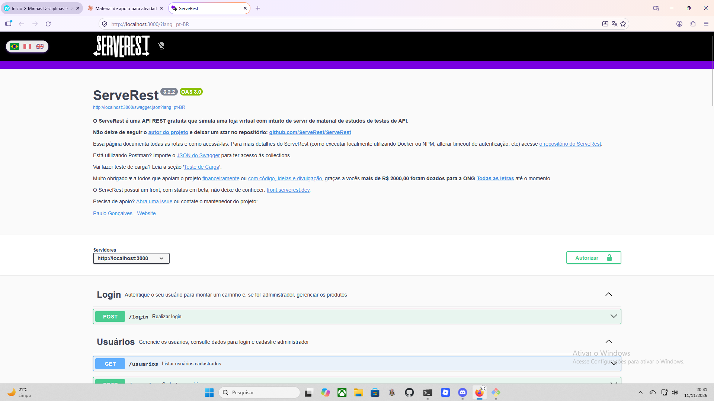
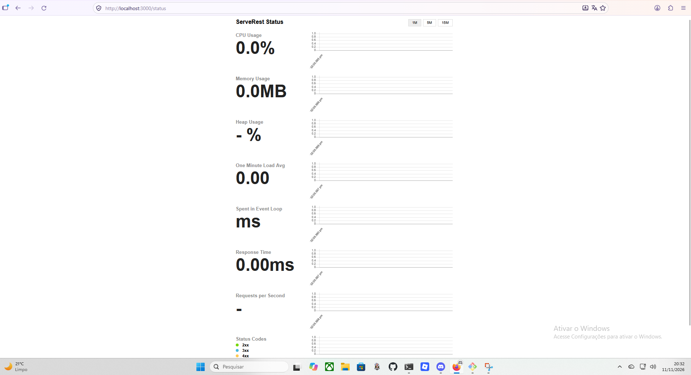
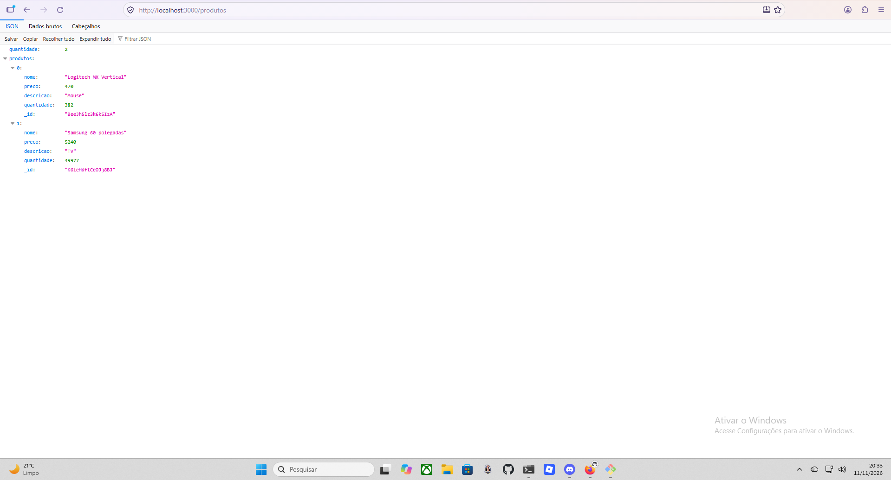
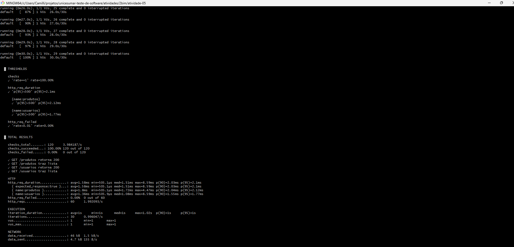
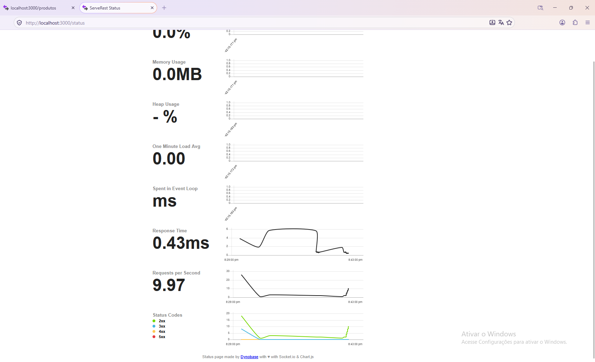
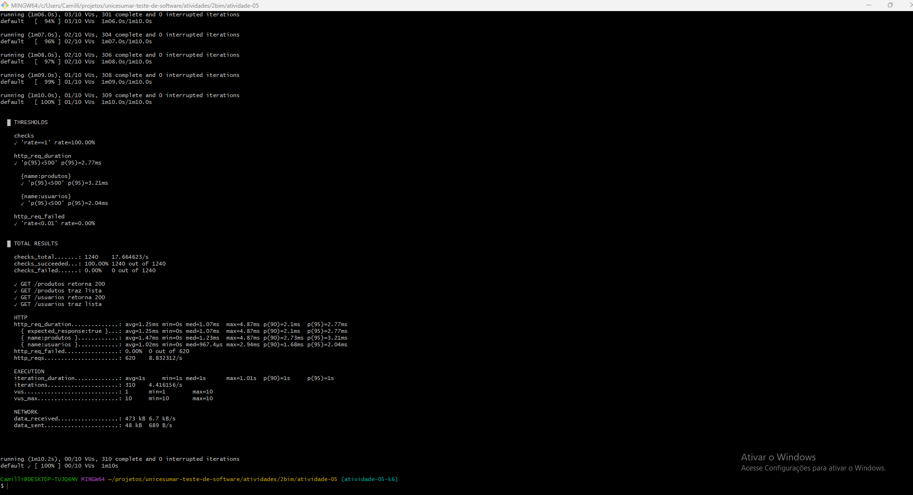
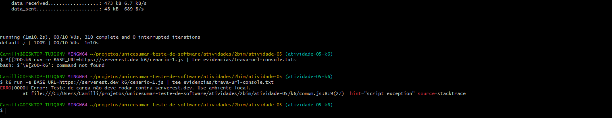

# Relatório – Atividade 05: Testes de Desempenho com k6 no ServeRest

**Disciplina:** Projeto, Implementação e Teste de Software
**Aluna:** Camilli
**Data:** 11/11/2026

## 1. Objetivo

Implementar testes de carga com k6 contra os endpoints `GET /produtos` e `GET /usuarios` do ServeRest e analisar o comportamento da API com 1 usuário virtual (VU) e com carga progressiva de até 10 VUs.

## 2. Ambiente

| Item | Valor |
|---|---|
| Sistema operacional | Windows 11 Pro, versão 25H2 (compilação 26200.9711) |
| Processador / memória | AMD Ryzen 5 5500 (3,60 GHz) / 16 GB (15,9 GB utilizáveis) |
| ServeRest | 3.2.2, local, via `npx serverest@latest`, em `http://localhost:3000` |
| k6 | v2.3.0 (go1.26.8, windows/amd64) |
| Execução | k6 e ServeRest na mesma máquina |

Nenhum teste foi executado contra `https://serverest.dev`, conforme a orientação da documentação do ServeRest. O script recusa essa URL (ver seção 9).

## 3. Cenários

Cada iteração faz `GET /produtos` e `GET /usuarios` e depois `sleep(1)`. Isso gera cerca de 2 requisições por segundo por VU.

- **Cenário 1 (carga inicial):** 1 VU durante 30 s.
- **Cenário 2 (carga progressiva):** stages de 10 s até 1 VU, 20 s até 5 VUs, 20 s até 10 VUs, 10 s descendo para 5 VUs e 10 s descendo para 0, totalizando 70 s.

A URL base é configurada pela variável de ambiente `BASE_URL` (padrão `http://localhost:3000`), sem alterar a lógica dos testes.

## 4. Checks e thresholds

**Checks (por resposta):** status 200 e corpo com a lista esperada (`produtos` e `usuarios`), em cada endpoint.

| Threshold | Justificativa |
|---|---|
| `http_req_duration` p(95) < 500 ms (global e por rota) | 500 ms é uma referência usual de resposta aceitável para uma API de leitura. O p95 foi escolhido porque a média esconde casos lentos. Como a API é local e leve, o limite é folgado e não foi ajustado ao resultado. |
| `http_req_failed` < 1% | Em leituras simples e sem dependências externas, qualquer taxa de erro relevante indica problema. |
| `checks` = 100% | Cada resposta precisa estar correta, não apenas rápida. Uma resposta rápida com conteúdo errado não é sucesso. |

## 5. Resultados

| Métrica | Cenário 1 | Cenário 2 |
|---|---|---|
| VUs (máx.) | 1 | 10 |
| Duração | 30,1 s | 70,2 s |
| Iterações | 30 | 310 |
| Total de requisições | 60 | 620 |
| Requisições/s (média) | 1,99 | 8,83 |
| Tempo médio de resposta | 1,58 ms | 1,25 ms |
| Mediana | 1,51 ms | 1,07 ms |
| p(90) | 2,03 ms | 2,10 ms |
| **p(95)** | **2,10 ms** | **2,77 ms** |
| Máximo | 8,59 ms | 4,87 ms |
| `/produtos` (média / p95) | 1,80 / 2,12 ms | 1,47 / 3,21 ms |
| `/usuarios` (média / p95) | 1,36 / 1,77 ms | 1,02 / 2,04 ms |
| Taxa de falhas (`http_req_failed`) | 0,00% (0 de 60) | 0,00% (0 de 620) |
| Checks | 100% (120 de 120) | 100% (1240 de 1240) |
| Thresholds | 5 de 5 aprovados | 5 de 5 aprovados |

## 6. Análise

**Vazão.** Com 1 VU, a taxa foi de 1,99 req/s, o esperado para 2 requisições por segundo. No Cenário 2, a média de 8,83 req/s decorre do formato dos stages: a soma dos VUs ao longo do tempo dá cerca de 315 VU-segundos, e foram feitas 310 iterações. O ServeRest acompanhou toda a carga pedida.

**Tempo de resposta.** O p95 passou de 2,10 ms para 2,77 ms (e de 2,12 para 3,21 ms em `/produtos`). Esse aumento é compatível com mais requisições concorrentes, mas é inferior a 1 ms. A média e a mediana, ao contrário, ficaram menores no Cenário 2. Uma explicação possível, não comprovada por este teste, é que o Cenário 1 tem poucas requisições (60), então o início da execução (conexão nova, código ainda "frio") pesa mais na média, o que também seria coerente com o máximo de 8,59 ms. Com uma rodada por cenário, não é possível afirmar a causa.

**Falhas e corretude.** Não houve falhas HTTP nem checks reprovados nos dois cenários. Nenhum 4xx ou 5xx apareceu no painel `/status` durante o Cenário 2.

**Efeito da carga.** Até 10 VUs, o aumento da carga elevou levemente a cauda do tempo de resposta (p95), sem degradação perceptível e sem comprometer nenhum critério. Os resultados não indicam o limite de capacidade da API.

## 7. Limitações

- k6 e ServeRest rodam na mesma máquina e disputam CPU, o que pode afetar os tempos.
- Cada cenário foi executado uma única vez, então não há estimativa de variação entre rodadas.
- A carga máxima é pequena (10 VUs, com `sleep(1)`), o que dá poucas requisições realmente simultâneas.
- Só foram testadas operações GET, em uma API de estudo com dados em memória e poucos registros. Não representa um ambiente de produção.
- Os tempos estão na casa de milissegundos e alguns valores mínimos aparecem como `0s`, o que mostra o limite de resolução da medição no Windows. Diferenças de décimos de milissegundo não são confiáveis.
- O painel `/status` mostrou CPU 0,0%, memória 0,0 MB e heap "-%", então não serve como evidência de uso de recursos neste ambiente. Foram usados apenas req/s, tempo de resposta e códigos de status.
- O limite de 500 ms ficou muito acima do observado. Em um cenário real, o critério deveria ser calibrado com base no SLO do serviço.

## 8. Conclusão

Nas condições testadas (ambiente local, 1 a 10 VUs, somente leituras), o ServeRest respondeu corretamente a 100% das requisições, com p95 de 2,10 ms e 2,77 ms nos dois cenários, sem falhas e com todos os thresholds aprovados. O aumento da carga elevou levemente o p95, sem impacto prático. Os dados não permitem concluir qual é a capacidade máxima da API. Isso exigiria testes mais intensos, repetidos e em ambiente isolado, o que ficou fora do escopo da atividade.

## 9. Evidências

**Ambiente**

**Cenário 1**

Dados completos: `evidencias/cenario1.json` e `evidencias/cenario1-console.txt`.

**Cenário 2**

O print do `/status` foi tirado na fase de descida da carga (9,97 req/s). Dados completos: `evidencias/cenario2.json` e `evidencias/cenario2-console.txt`.

**Trava de segurança (URL pública bloqueada)**

Dados: `evidencias/trava-url-console.txt`.
